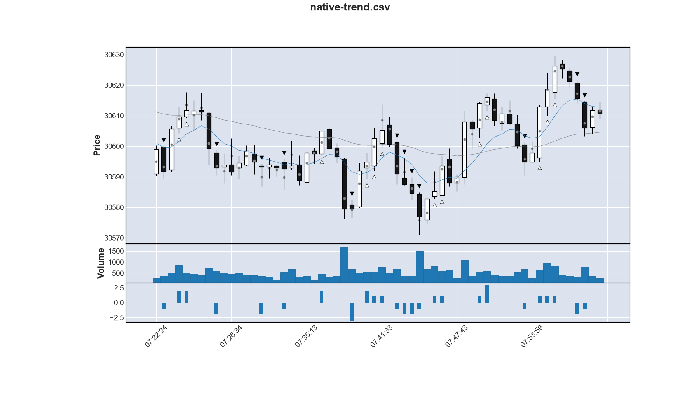
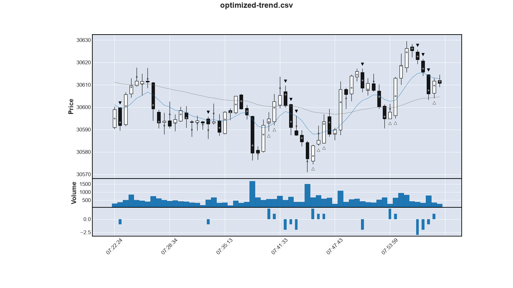

Yesterdays Weather implemented
=================================

Yesterdays Weather ist ein Trader/Trading Strategie, die auf die Verfolgung von Trends basiert:
_The trend is your friend_!
In [Ferdinands Strategie](N013-ferdinands-strategie.md) setzt er damit Punkt 4 um,
die Strategie der Änfanger.

Funktionsweise von Yesterdays Weather
---------------------------------------

Konkret heißt das, dass Yesterdays Weather einsteigt, sobald sich ein Trend zeigt.
Der kleinst-mögliche Trend ist, dass dich der Future zweimal hintereinander in dieselbe Richtung bewegt.
Wenn dann die aktuelle Kerze dazu auch noch passend steigt oder fällt,
haben wir einen Trend und steigen ein.

Die folgende Abbildung zeigt Yesterdays Weather in Aktion:

Die keinen Dreicke markieren die Einstiegssignal.
Der graue Punkt in der Mitte der Kerzen ist der gewichtet Durchschnitt.
Er dient als Referenz.
Man sieht sehr schön: Immer wenn drei graue Punkte sich in in dieselbe Richtung bewegen,
erfolgt ein Einstiegssignal.

Um zu beurteilen, wie gut die Einstiegssignale sind,
wenden wir ein einfaches Verfahren an:
Wir schauen eine gewissen Zeit voraus (4 Kerzen).
Wenn der gewichtete Durchschnitt der 4. Kerzen in der Richtung des Einstiegssignals liegt,
dann betrachten wir das Signal als erfolgreich.

Führt man diese Bewertung auf den historischen Daten aus,
erhält man folgende Zahlen:

          date symbol  wins  trades  win_rate
    2026-09-24  MNQZ6   438     757  0.578600
    2026-09-25  MNQZ6   424     740  0.572973
    2026-09-28  MNQZ6   435     780  0.557692
    2026-09-29  MNQZ6   404     748  0.540107
    2026-09-30  MNQZ6   400     763  0.524246
    2026-10-01  MNQZ6   452     778  0.580977
    2026-10-02  MNQZ6   410     759  0.540184
    2026-10-05  MNQZ6   412     781  0.527529
    2026-10-06  MNQZ6   407     729  0.558299
    2026-10-07  MNQZ6   374     718  0.520891
    2026-10-08  MNQZ6   386     782  0.493606
    2026-10-09  MNQZ6   445     810  0.549383
                Total  4987    9145  0.545325

Mit dieser einfachen Bewertung wären 54.5% der Einstiegssignal richtig.

Der große Nachteil bei dieser Trend-Erkennung ist,
dass man den Trend oft dann erst erkennt, wenn es fast schon wieder vorbei ist.
Schön zu sehen ist das an der weißen Kerzen mit einem Long-Einstiegssignal
kurz nach 07:35:13.

Die blaue Linie im Diagramm ist ein exponentieller Moving-Average (EMA).
Falsche Einstiegssignale dieser Art passieren sehr häufig, 
wenn sich der Kurz bereits (weit) über dem EMA9 liegt.
Deshalb ist ein Verbesserung, keine Einstiegsignale mehr zu erzeugen,
wenn die ganze Kerze bereits über dem EMA9 liegt.

Das nächste Bild zeigt das veränderte Verhalten mit dieser Verbesserung:

Wie man sieht, ist an der weißen Kerze kurz hinter 07:35:13 jetzt kein Einstiegssignal mehr zu sehen.
Auch die Auswertung über die historischen Daten zeigen diese Verbesserung:

          date symbol  wins  trades  win_rate
    2026-09-24  MNQZ6   167     280  0.596429
    2026-09-25  MNQZ6   179     307  0.583062
    2026-09-28  MNQZ6   213     354  0.601695
    2026-09-29  MNQZ6   164     298  0.550336
    2026-09-30  MNQZ6   166     319  0.520376
    2026-10-01  MNQZ6   184     287  0.641115
    2026-10-02  MNQZ6   176     310  0.567742
    2026-10-05  MNQZ6   185     359  0.515320
    2026-10-06  MNQZ6   181     300  0.603333
    2026-10-07  MNQZ6   168     295  0.569492
    2026-10-08  MNQZ6   170     334  0.508982
    2026-10-09  MNQZ6   187     332  0.563253
          None  Total  2140    3775  0.566887

Es zeigt sich ein Verbesserung von 54.5% auf 56.7% (+2.2%).

Wir vermeiden jetzt, dass wir zu spät auf den Zug aufspringen.
Das lohnt sich, wie die Zahlen zeigen.
Aber wenn wir jetzt wissen, dass ein Trend oft dann in die Gegenrichtung umschlägt,
wenn er sich weit vom EMA9 entfernt hat,
dann könne wir die Entfernung vom EMA9 auch nutzen
und etwas früher einsteigen.

Anstatt auf eine bereits etablierten Trend zu warten,
steigen wir auch ein, wenn eine Bewegung von weit weg vom EMA9 in Richtung EMA9 erfolgt.

In der obigen Abbildung sieht man das geänderte Verhalten an der ersten schwarzen Kerze nach 07:41:33:
Hier wird auf die Trendänderung spekuliert, was in diesem Fall richtig war.
Es folgt ein schöner Abwärtstrend.

Mit den ergriffenen Maßnahmen und dem oben erläuterten Bewertungsverfahren
erreicht _Yesterdays Weather_ folgende Werte auf den historischen Daten:

          date symbol  wins  trades  win_rate
    2026-09-24  MNQZ6   253     434  0.582949
    2026-09-25  MNQZ6   259     451  0.574279
    2026-09-28  MNQZ6   310     496  0.625000
    2026-09-29  MNQZ6   245     432  0.567130
    2026-09-30  MNQZ6   259     471  0.549894
    2026-10-01  MNQZ6   260     454  0.572687
    2026-10-02  MNQZ6   256     436  0.587156
    2026-10-05  MNQZ6   264     495  0.533333
    2026-10-06  MNQZ6   267     434  0.615207
    2026-10-07  MNQZ6   230     410  0.560976
    2026-10-08  MNQZ6   249     478  0.520921
    2026-10-09  MNQZ6   286     482  0.593361
                Total  3138    5473  0.573360

Die Auswertung zeigt einen weiteren Gewinn von 0.6% auf nun 57.3%.
Ob und wieviel Gewinn dabei herausspringt,
wird man sehen, sobald der Trading-Simulator fertig ist.
Aber selbst dieser einfache Algorithmus erscheint vielversprechend.

Welche Zykluszeit ist die Richtige?
--------------------------------------

Mit den jetzt vorhanden Analysemöglichkeiten kann man weitere Optimierungsfragen beantworten:

Der Trading-Zyklus war im obigen Bespiel 36 sec.
36 ist ein sehr schöne Zahl:
36 ist 3 x 12, also drei Duzend.
Alle guten Dinge sind bekanntlich drei
und das Duzend is eine der verbreitesten Einheiten weltweit.

Dann sind 36 sec eine 100stel Stunde.
Die Stunde hat nämlich 3600 Sekunden.

Mit 36 sec Trading-Zyklus sind wir deutlich schneller als der Retail-Trader.
Der schaut auf 1-min-Kerzen.
Im Gegensatz zu 30 sec laufen wir mit 36 sec nicht die Gefahr,
in Resonanz mit den 1-min-Tradern zu geraten.
Deshalb ist ein 36-Sekunden-Takt sehr vielversprechend.

Wir können uns nun aber auch anschauen,
welche Ergebnisse eine andere Zykluszeit hervorbringen.
Dasselbe Bewertungskriterium auf denselben Daten angewandt,
bringt folgende Ergebnisse:

     cycle  wins  trades  win_rate
        24  4687    8141  0.575728
        30  3734    6623  0.563793
        36  3138    5473  0.573360
        42  2644    4767  0.554647
        48  2219    4010  0.553367
        60  1816    3281  0.553490

Die Unterschiede sind nicht sehr groß.
Das bester Ergebnis erziehlt der 24-sec-Takt mit 57.6%,
0.3%-Punkte besser als der 36er-Takt.
Alle anderen Takte sind schlechter.
Am schlechtesten schneidet 48er-Takt mit 55.3% ab.

Allerdings ist die Anzahl der Trades beim 24-Sekunden-Takt
deutlich höher als beim 36-Sekunden-Takt: 8141 zu 5473.
Alles in allem zeigt auch diese Auswertung,
dass der 36-Sekunden-Takt der am besten geeignetste scheint.

Fazit
--------

Der einfache Algorithmus, der in Yesterdays Weather implementiert ist,
könnte bereits rentabel werden.
Mehr dazu muss der Trading-Simulator zeigen.

Man sieht auch, wie man mit einfachen Mittel die Ergebnisse verbessern kann:
Setzt man den aktuellen Kurs in Bezug zum gleitenden Durchschnitt,
dann kann man besser entscheiden.
Das war das Beispiel von oben.
Aber von solchen Kennzahlen und Regeln gibt es sich noch tausende mehr.
Das ist der Punkt, an dem die KI ins Spiel kommt.
Es macht wenig Sinn, den Algo manuell weiterzuentwickeln.
Das kann die KI besser.

Dafür braucht es die richtigen Kennzahlen und viele Daten.
Wie [Gradient Boosting](N004-gradient-boosting.md) beschrieben,
ist das das geeignet Verfahren.
Erste Kennzahlen habe ich schon.
Die zweite Version des Bots sollte mit KI laufen...

Anhang: Vollständig Ergebnisse der Zykluszeiten-Untersuchung
-------------------------------------------------------------

Hier zur Vollständigkeit die gesamten Ergebnisse

### 24-Sekunden-Takt

          date symbol  wins  trades  win_rate
    2026-09-24  MNQZ6   369     655  0.563359
    2026-09-25  MNQZ6   358     629  0.569157
    2026-09-28  MNQZ6   429     717  0.598326
    2026-09-29  MNQZ6   394     692  0.569364
    2026-09-30  MNQZ6   386     690  0.559420
    2026-10-01  MNQZ6   390     702  0.555556
    2026-10-02  MNQZ6   396     700  0.565714
    2026-10-05  MNQZ6   411     690  0.595652
    2026-10-06  MNQZ6   385     657  0.585997
    2026-10-07  MNQZ6   379     643  0.589425
    2026-10-08  MNQZ6   404     729  0.554184
    2026-10-09  MNQZ6   386     637  0.605965
                Total  4687    8141  0.575728

### 30-Sekunden-Takt

          date symbol  wins  trades  win_rate
    2026-09-24  MNQZ6   323     577  0.559792
    2026-09-25  MNQZ6   266     485  0.548454
    2026-09-28  MNQZ6   358     601  0.595674
    2026-09-29  MNQZ6   311     529  0.587902
    2026-09-30  MNQZ6   300     563  0.532860
    2026-10-01  MNQZ6   302     554  0.545126
    2026-10-02  MNQZ6   326     553  0.589512
    2026-10-05  MNQZ6   322     583  0.552316
    2026-10-06  MNQZ6   313     541  0.578558
    2026-10-07  MNQZ6   281     514  0.546693
    2026-10-08  MNQZ6   300     564  0.531915
    2026-10-09  MNQZ6   332     559  0.593918
                Total  3734    6623  0.563793

### 42-Sekunden-Takt

          date symbol  wins  trades  win_rate
    2026-09-24  MNQZ6   220     390  0.564103
    2026-09-25  MNQZ6   205     392  0.522959
    2026-09-28  MNQZ6   248     431  0.575406
    2026-09-29  MNQZ6   220     396  0.555556
    2026-09-30  MNQZ6   220     392  0.561224
    2026-10-01  MNQZ6   197     387  0.509044
    2026-10-02  MNQZ6   219     386  0.567358
    2026-10-05  MNQZ6   235     435  0.540230
    2026-10-06  MNQZ6   216     391  0.552430
    2026-10-07  MNQZ6   211     359  0.587744
    2026-10-08  MNQZ6   226     420  0.538095
    2026-10-09  MNQZ6   227     388  0.585052
                Total  2644    4767  0.554647

### 48-Sekunden-Takt

          date symbol  wins  trades  win_rate
    2026-09-24  MNQZ6   195     330  0.590909
    2026-09-25  MNQZ6   185     332  0.557229
    2026-09-28  MNQZ6   195     351  0.555556
    2026-09-29  MNQZ6   209     345  0.605797
    2026-09-30  MNQZ6   191     351  0.544160
    2026-10-01  MNQZ6   174     330  0.527273
    2026-10-02  MNQZ6   171     343  0.498542
    2026-10-05  MNQZ6   170     329  0.516717
    2026-10-06  MNQZ6   172     327  0.525994
    2026-10-07  MNQZ6   179     309  0.579288
    2026-10-08  MNQZ6   183     343  0.533528
    2026-10-09  MNQZ6   195     320  0.609375
                Total  2219    4010  0.553367

### 60-Sekunden-Takt

          date symbol  wins  trades  win_rate
    2026-09-24  MNQZ6   157     276  0.568841
    2026-09-25  MNQZ6   153     269  0.568773
    2026-09-28  MNQZ6   158     283  0.558304
    2026-09-29  MNQZ6   152     275  0.552727
    2026-09-30  MNQZ6   152     270  0.562963
    2026-10-01  MNQZ6   124     254  0.488189
    2026-10-02  MNQZ6   147     281  0.523132
    2026-10-05  MNQZ6   139     277  0.501805
    2026-10-06  MNQZ6   153     288  0.531250
    2026-10-07  MNQZ6   174     268  0.649254
    2026-10-08  MNQZ6   158     270  0.585185
    2026-10-09  MNQZ6   149     270  0.551852
                Total  1816    3281  0.553490