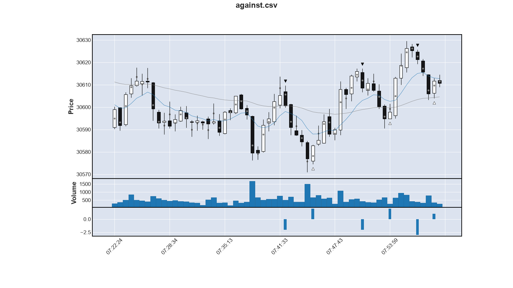
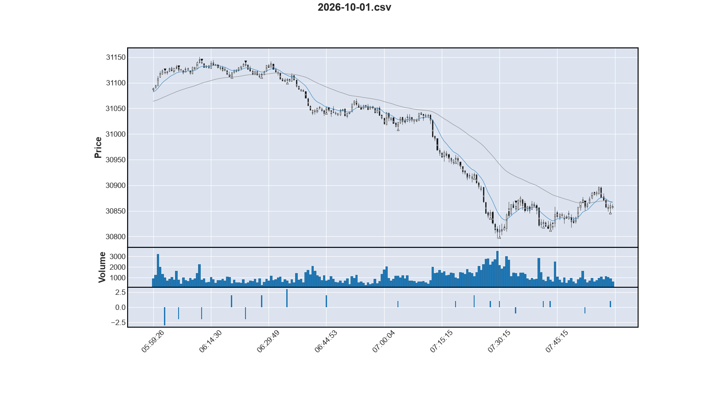

Yesterdays Weather revised
=============================

In [Yesterdays Weather implemented](N017-yesterdays-weather-implemented.md)
beschrieb ich die Funktionsweise von Yesterdays Weather,
einem Algo, der dem Trend folgen will.
Dabei zeigte ich auch auf, mit welchen Maßnahmen es gelang, den Algo zu optimieren.

Die zweite Maßnahme dabei war, auf eine Trendumkehr zu spekulieren:
Ist der aktuelle Kurs weit weg vom EMA9 und bewegt sich dann darauf zu,
ist das das Signal für den Einstieg.
Durch diese Zusatzmaßnahme konnte noch ein wenig herausgeholt werden.

Im Nachhinein kam mir der Gedanke, dass man das auch anders herum sehen könnte:
Geht man gedanklich davon aus, man hat einen Algo, der auf Trendumkehr spekuliert
und versucht diesen durch den Trendfolge-Algorithmus zu verbessern,
dann dürfte das nicht gelingen, sondern es müsste eine Verschlechterung eintreten.

Was passiert also, wenn man den Trendfolge-Algo weglässt und nur den Trendumkehr-Algo einsetzt?

Die folgende Abbildung zeigt den Ausschnit des Charts,
wie er auch in [Yesterdays Weather implemented](N017-yesterdays-weather-implemented.md) immer weider zu sehen war.
Diesmal allerdings nur mit der Trendumkehr-Funktion:

Es fällt auf, dass es nur 6 Einstiegssignale gibt, die alle sehr, sehr gut aussehen!

Hier die Zahlen, wenn man diesen Algo auf die historischen Daten loslässt:

          date symbol  wins  trades  win_rate
    2026-09-24  MNQZ6    86     154  0.558442
    2026-09-25  MNQZ6    80     144  0.555556
    2026-09-28  MNQZ6    97     142  0.683099
    2026-09-29  MNQZ6    81     134  0.604478
    2026-09-30  MNQZ6    93     152  0.611842
    2026-10-01  MNQZ6    76     167  0.455090
    2026-10-02  MNQZ6    80     126  0.634921
    2026-10-05  MNQZ6    79     136  0.580882
    2026-10-06  MNQZ6    86     134  0.641791
    2026-10-07  MNQZ6    62     115  0.539130
    2026-10-08  MNQZ6    79     144  0.548611
    2026-10-09  MNQZ6    99     150  0.660000
                Total   998    1698  0.587750

58.8% bei _nur_ 1698 Trades.

Im Vergleich dazu nochmal die Zahlen des Trendfolge-Algo ohne Trendumkehr-Zusatz:

                      wins  trades  win_rate
    Nur Trendfolge:   2140    3775  0.566887
    Nur Trendumkehr:   998    1698  0.587750
    Kombiniert:       3138    5473  0.573360

Die Trendumkehr hat den Trendfolge-Algo von 56.7% auf 57.3% verbessert.
Aber umgekehrt verschlechtert der Trendfolge-Algo den Trendumkehr-Algo von 58.8% auf 57.3%.
Das sind satte 1.5%!

Es scheint so, als wäre Trendumkehr erfolgreicher als Trendfolge...

Betrachtet man die Daten der einzelnen Tage,
dann fällt auf, dass der Trendumkehr-Algo wesentlich stärker variiert:

 * 45.5% am 2026-10-01
 * 68.3% am 2026-09-28

Offenbar ist der Erfolg diese Ansatzes sehr viel stärker von den Marktgegebenheiten abhängig,
als der Trendfolge-Algo.

Die folgende Abbildung zeigt einen Ausschnitt von 2026-10-01.
Vielleicht liefert das schon die Erklärung, weshalb Trendumkehr an diesem Tag so schlecht funktionierte
und dem Trend folgen viel besser war
(Trendfolge hatte an diesem Tag 64%!):

Man sieht einen lang anhaltenden starken Abwärtstrend.
Unser Algo spekuliert immer wieder dagegen und verliert.

Fazit
------

Offensichtlich können sich beide Algos ergänzen.
Die Frage ist, wie man erkennen kann, was im jetzigen Augenblick gerade das richtige ist.
