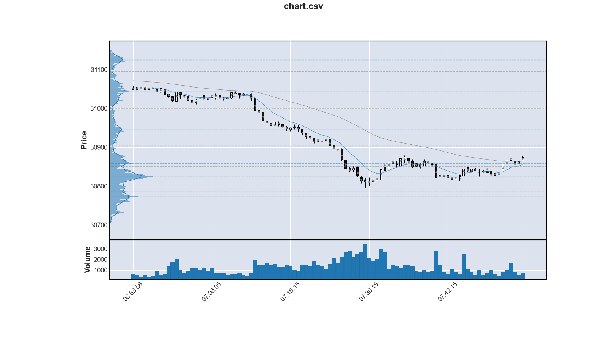
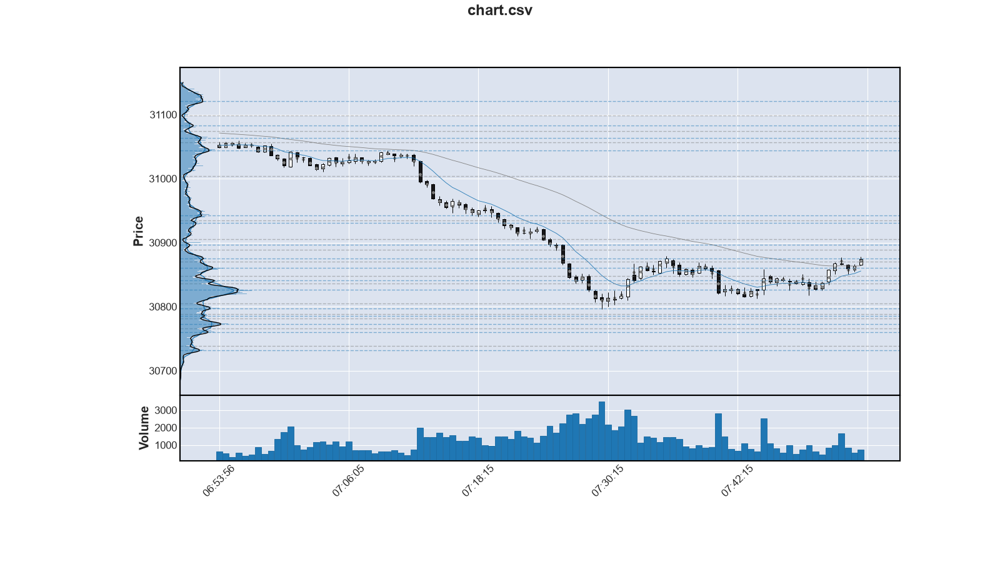
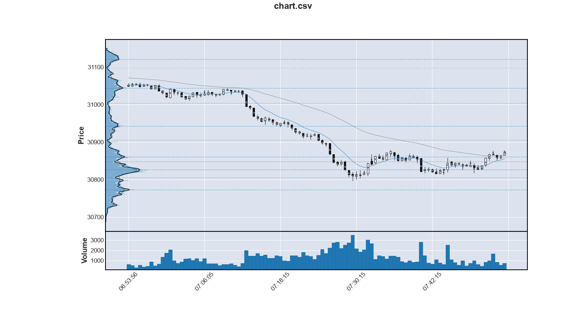

Savitzky-Golay-Filter for volume profile
===========================================

Die folgende Abbiltung zeigt das Chart, dass wir aus [N018](N018-yesterdays-weather-revised.md) bereits kennen.
Es ist ein Ausschnitt vom 01.10.2026.
Diesmal ist das Volumenprofil mit den Hochs auch noch die Tiefs zusätzlich eingezeichnet (blaue/graue gestrichelte Linie für Hoch/Tief).

Man sieht sehr schön, wie der Kurs an den Widerstandslinien (den Hochs) verharrt,
um dann sehr schnell durch die Täler durchzulaufen zum nächsten Hoch.
Aber das ist nicht das Thema dieser Note.

Für die Glättung des Volumenprofiles wurde ein gleitenden Durchschnitt verwenden.
Das Fenster war in Abhängigkeit der ATR gewählt.
Ein alternatives Filter, das den Orginalverlauf besser erhält,
ist das [Savitzky-Golay-Filter](https://de.wikipedia.org/wiki/Savitzky-Golay-Filter),
das zufälligerweise in `scipy` implementiert ist.
(`scipy` verwenden wir bereits, um die Höhen und Tiefen zu erkennen.)

Die Konsequenz aus dem besser erhaltenen Signalverlauf ist allerdings,
dass viel mehr Höhen und Tiefen erkannt werden.
Die folgende Abbildung zeigt das eindrucksvoll:

Um die Anzahl der Höhen und Tiefen in den Griff zu bekommen,
bietet `sicpy.find_peaks` den Parameter `prominence`.
Er gibt an, um wieviel sich ein Peak von seiner Umgebung abheben muss.

Im Orginal was dieser Parameter auf 10% eingestellt.
Erhöht man für das Savitzky-Golay-Filter diesen Parameter auf 25%,
dann erhält man dieselbe Anzahl an Peaks, wie im Orginal.

Man sieht jetzt aber auch, dass sich die Positionen der Hochs/Tiefs
nicht vom Orginal unterscheiden.
Deshalb lohnt sich der erhöhte (Rechen-)Aufwand für diese Filterung nicht.
Eine Filterung mit einem gleitenden Durchschnitt ist gut genug.
