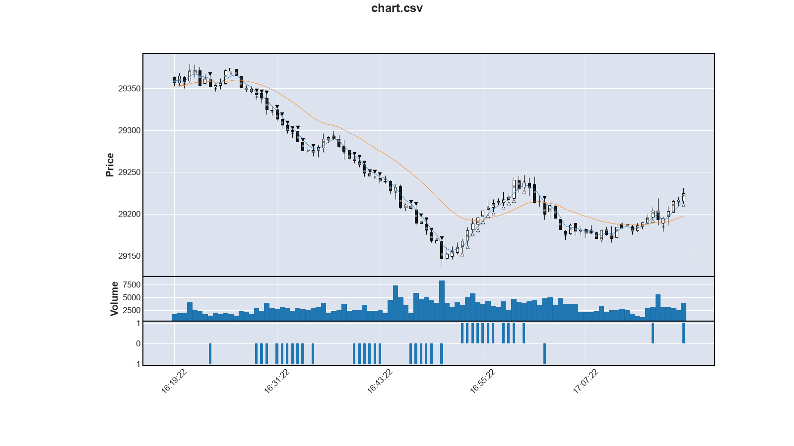
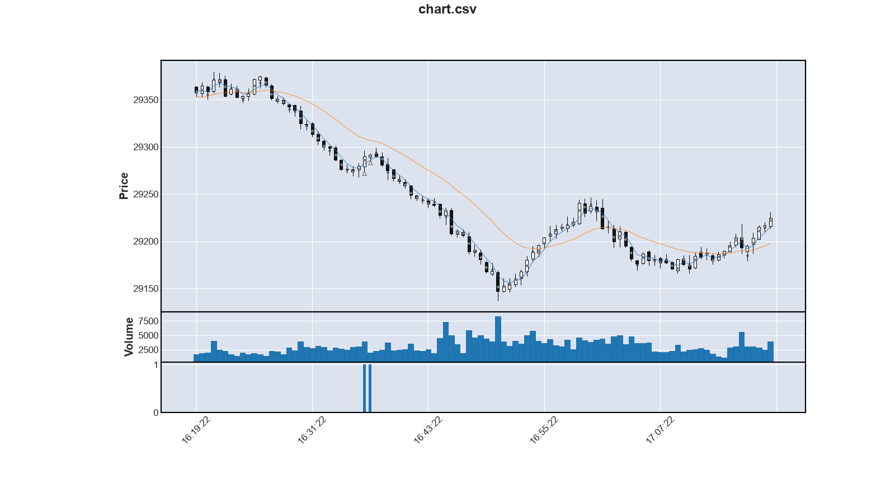
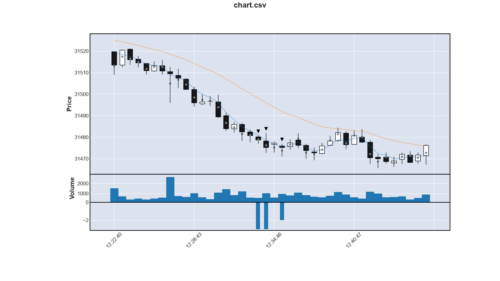

Yesterdays Weather simplified
==================================

Die Idee von _Yesterdays Weather_ ist, dem Trend zu folgen.
Dazu muss man den Trend erkennen.
Der erste Ansatz war, der kleinst mögliche Trend wird genommen und verfolgt.
_Kleinst möglicher Trend_ bedeutet:

Der Durschnitt von 2 aufeinanderfolgen Kerzen bewegt sich in dieselbe Richtung.

Zusätzlich kam dann noch die Bedingung dazu,
dass sich auch die akutelle Kerze in diese Richtung bewegen muss.
Bei früheren Kerzen ist die Richtung der Kerze nicht relevant.

Durch die Kürze des Trends erfolgten sehr vielen Einstiegssignale.
Dummerweise auch oft falsch.
Um die schlechten von den guten zu trennen,
bekam Yesterdays Weather immer mehr Zusatzlogik.
Ziel war es, möglichst am Anfang eines Trends bereits dabei zu sein
und nur dann einzusteigen, wenn die Chancen groß sind, dass er sich fortstetzt.

So kamen Abfragen zur relativen Position zum gleitenden Durchschnitt
oder des Gradienten des Trends hinzu.
Langsam wurde dadurch Yesterdays Weather immer mehr zu einem Trend-Umkehr-Erkenner.
In [Yesterdays Weather revised](N018-yesterdays-weather-revised.md) ist mir das klar geworden.

Yesterdays Weather vs. Turning Point
--------------------------------------

Die darauf folgende Maßnahme war es,
einen neuen Trader zu definieren, der auf die Trendumkehr spekuliert.
Dieser Trader heißt `TurningPoint`.
In diesem Trader können jetzt Verfahren zur Trendumkehrerkennung eingebaut
und erforscht werden.

Mit der Existenz von TurningPoint konnte auch Yesterdays Weather von allem befreit werden,
was versucht Trendumkehrungen zu entdecken.
Bei diesem Umbau wurde Yesterdays Weather parametriebar:
Die Trendlänge konnte eingestellt werden.

Die Trendlänge beeinflusst sehr stark, 
wieviel Einstiegssignal generiert werden:
Je länger der Trend, desto weniger Einstiegssignale.

Einen längeren Trend zu erkennen, braucht aber auch entsprechend länger Zeit.
Die Gefahr steigt, erst dann einzusteigen, wenn der Trend schon vorbei ist.
Hier gilt es, einen Kompromiss zu finden.

Die folgende Abbildung ist das Paradies für Yesterdays Weather.

Die Trendlänge ist in diesem Beispiel auf 4 eingestellt.
Man sieht sehr schön, wie häufig er einen 4er Trend erkennt.
Immer dann gibt er ein Einstiegssignal.

Im Gegensatz dazu liefert Turning Point nur ein Einstiegsignale.
Blöderweise auch noch ein Falsches:

Einfluss der Trendlänge
---------------------------

Die folgende Tabelle zeigt die Statistik von Yesterdays Weather mit unterschiedlichen Trendlängen
jeweils am selben Tag (06.10.2026):

    length  trades    wins  losses  win_rate  ticks  total  p_factor  max_win  max_loss
         1     635     175     460     27.56  -1147  -2392    0.8443      492       -63
         2     371      99     272     26.68   -606   -983    0.8893      480       -56
         3     199      64     135     32.16   -142   -237    0.9478      465       -60
         4     110      36      74     32.73    143    376    1.1560      438       -55
         5      62      20      42     32.26     44    111    1.0795      423       -60
         6      39      14      25     35.90      2    -81    0.8991      154       -55
         7      21       5      16     23.81    -90   -260    0.4790      154       -51
         8      10       2       8     20.00      5    -62    0.7019      140       -55
         9       4       1       3     25.00     37     69    2.1695      128       -36
        10       2       2       0    100.00     41     87    0.0000       72         0
        11       3       0       3      0.00    -50   -105    0.0000        0       -48
        12       3       0       3      0.00    -61   -122    0.0000        0       -48
        13       2       0       2      0.00    -40    -80    0.0000        0       -48
        14       1       0       1      0.00    -24    -48    0.0000        0       -48

Ab einer Trendlänge von 15 gibt es keine Einstiegssignal mehr.

In der Tabelle sieht man sehr schön, wie die Anzahl der Trades abnehmen mit höheren Trendlängen.
Auch sieht man, wie sich die Win Rate zunächst steigert,
um dann wieder abzufallen.
Bei 6 erreicht sie einen Peak von 36.9%.
Alles in allem ist jedoch für diesen Tag der 4er Trend der Sweap Spot:
Hier liegt die Win Rate bei 32.7% und es wird der größte Gewinn gemacht: 376 Ticks.

Bei der Länge von 10 gibt es die Koriosität: Beide Trades erfolgreich waren,
obwohl bei einer Länge von 9 nur einer erfolgreich
und bei längeren Trends gar kein Trade mehr erfolgreich war.

Für die längeren Trends ist das plausibel: Sie steigen zu spät ein.
Ein Blick auf das folgende Chart erklärt, warum der 9er Trend einmal weniger erfolgreich war.

Auf diesem Diagramm sieht man die Einstiegssignal für den 10er Trend.
Der 9 Trend steigt eine Kerze früher ein und bleibt dann an der nächsten Kerze hängen.
Da der 10er Trend erst bei dieser Kerze einsteigt, kann er sie überwinden und ins Plus gelangen.

Trendlänge 4 als Sweap Spot
------------------------------

Die folgende Tabelle zeigt die Ergebniss für eine Trendlänge von 4 an unterschiedlichen Tagen:

    day         trades    wins  losses  win_rate  ticks  total  p_factor  max_win  max_loss
    2026-09-28     129      37      92     28.68   -204   -608    0.7930      339       -56
    2026-10-06     110      36      74     32.73    143    376    1.1560      438       -55
    2026-10-14     119      39      80     32.77    131    590    1.2376      708       -52
    2026-10-22     111      36      75     32.43    929    949    1.4192      406       -52
    total          469     148     321     31.56    999   1307    1.1521      708       -56

Der 22.10.2026 wäre ein sehr erfolgreicher Tag gewesen.
Der 28.09.2026 allerdings sehr negativ.
In Summer wäre ein Gewinn von 1307 Ticks zusammen gekommen bei 469 Trades.

Fazit
-------

Alles in Allem zeigt sich,
dass Yesterdays Weather nach wie vor zu vielen Trades neigt,
von denen immer noch viele schlecht sind.
Dementsprechend ist auch das Risiko hoch, dass mal viel schief geht.

Eine Win Rate von 31% mit ein Profit Faktor von 1.15 ist nicht gut.
Yesterdays Weather kann nicht in Betrieb genommen werden.
Vielleicht schafft es Turning Point.
