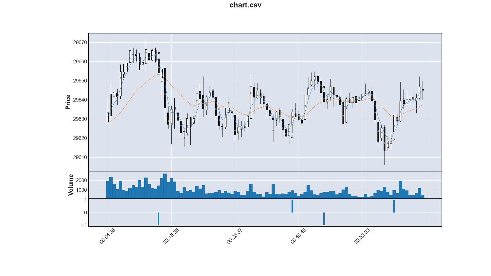
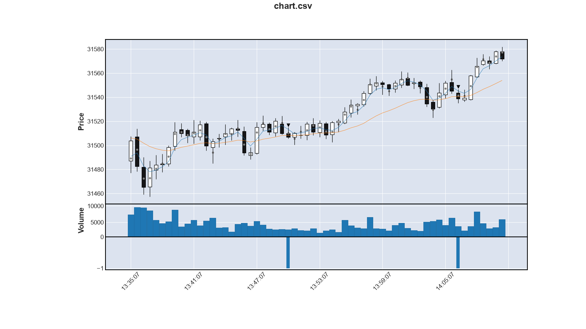
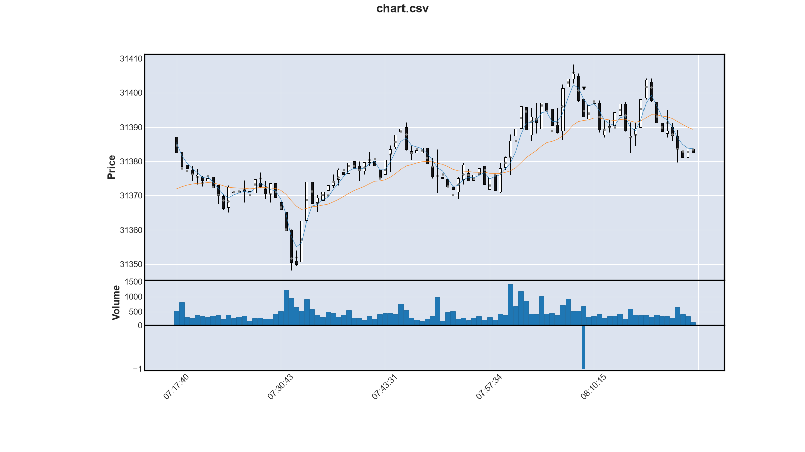
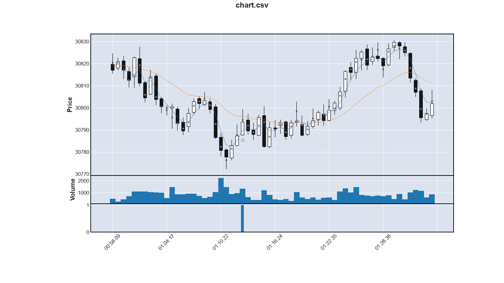

Turning Point: Overlap approch
==================================

Turning Point versucht den Start eines Trends zu erkennen.
Der bisherige Ansatz war,
den Abstand zwischen schnellen und langamen Durchschnitt zu bewerten.

Hintergrund: Ist der schnelle Durchschnitt weit weg vom langsamen Durchschnitt,
so ist die Chance groß, dass er wieder zurückkehrt.
Gehen dann die Kerzen in diese Richtung, ist as ein Einstiegssignal.

Die Praxis hat gezeig, dass das sehr viele falsche Einstiegsignal liefert.
Meist wenn ein langer, starker Trend in Takt ist und dann eine kurzfristige Gegenbewegung kommt.
Dann steigt Turning Point an der Gegenbewegung ein und liegt komplett falsch,
weil sich dann der langfristige Trend weiter fortsetzt.

Im Chart erkennt man das sehr gut:
Die Kerzen sind noch weit weg vom langsamen Durchschnitt.
Wenn das so ist, dann sollte man besser weg bleiben.

Überlappungsansatz
---------------------

Der neue Ansatz steigt dann ein, wenn der kurzfristige Trend sehr stark ist
und es eine stark steigende Kerze gibt, die beide Trends miteinander verbindet.
Die folgende Abbildung zeigt das exemplarisch:

Bei allen drei Einstiegssignalen sieht man sehr schön die Kerze,
die beide Trends überspannt.
Es folgt in allen drei Fällen eine schöne Aufwärtsbewegung.

Bei ersten und dritten Signal können wir mit der bisherigen Stop-Loss-Logik die Aufwärtsbewegung gut ausnutzen.
Beim zweiten Einstiegssignal werden wir zu früh ausgestoppt.
Deshalb wird das vermutlich ein Verlust werden,
obwohl das Einsstiegssignal für sich genommen richtig ist.

Erste Ergebnisse
-------------------

Die folgende Tabelle zeigt erste Ergebnisse für Turning Point mit dem Overlap Ansatz:

    trades    wins  losses  win_rate  ticks  total  p_factor  max_win  max_loss
        12       8       4     66.67    321    321    3.9450      148       -36

Diese Wert wurden am 19.10.2026 erreicht.

Die Einstellung waren wir folgt (alles in absoluten Zahlen gesetzt):
 
 * Keine Handlung, wenn die Range der aktuelle Kerze > 50 Ticks ist.
 * Der Gradient des schnellen Filters und der aktuellen Kerze muss mind. 12 sein
 * Der Stop-Loss beträgt 50 Ticks
 * Faktor für die Stop-Loss-Nachführung ist 0.5
 * Max-Loss entspricht Stop-Loss. Deshalb wird immer nur ein Stück gekauft.

66% Win Rate und 3.9 Profit Faktor sind sehr vielversprechend.
Mal sehen, wie die Werte für die Referenztage aussehen:

    day         trades    wins  losses  win_rate  ticks  total  p_factor  max_win  max_loss
    2026-10-22       7       2       5     28.57     -7     -7    0.9239       64       -27
    2026-10-14       8       2       6     25.00    -89    -89    0.3407       44       -51
    2026-10-06       5       2       3     40.00    -11    -11    0.8675       41       -43
    2026-09-28      11       5       6     45.45    150    150    2.1811      115       -51
    total           31      11      20     35.48     43     43                115       -51

Verblüffenderweise sind 3 von 4 Tagen negativ.
Der vierte Tag reißt es aber raus und sorgt insgesamt für ein positives Ergebnis.
Woran liegt es, dass die anderen 3 Tage so schlecht waren?

Was geht schief?
-------------------

### 2026-10-06

Das folgende Chart zeigen zwei Verlusttrades des 10.06.2026:

An diesen Stellen sollten keine Einstiegssignal sein.
Warum nicht: Es ist keinerlei Dynamik im Spiel.
Wir siechen in einer Seitwärtsbewegung dahin und erfüllen zufällig die oben gennanten Kriterien.

In ursprünglichen TurningPoint-Ansatz musste der schnelle Durchschnitt einen Mindestabstand vom langsamen haben.
Dieser Abstand fiehl beim Überlappungsansatz weg.
Das war wohl ein Fehler.
Der Mindestabstand muss wieder rein.

Beim dritten Verlust ist das Einstiegssignal gar nicht so verkehrt.
Allerdings werden wir gleich ausgestoppt.
Das ist ein typischer Fall der häufig auftritt:
Wir steigen genau mit der Kerze ein, die ein Gegenbewegung macht.
Das führt dann zu maximalem Verlust.

Hier brauchen wir ein besseres Einstiegsverhalten.
Das kann das Einstiegssignal nicht leisten.

### 2026-10-14

Am 14.06.2026 sind 6 Trades schief gegangen:

 * 4x Einstieg direkt in die Gegenbewegung (t=202,294,419,939)
 * 2x Früh ausgestoppt (t=832,2102)

Da war viel Pech dabei. Aber kann man auch was tun?

Das folgende Chart zeigt den misslungenen Trade bei t=294:

Die Kerze, die das Einstiegssignal auslöste, zeigt Auffälligkeiten:
 1. Der gewichtete Durchschnitt ist außerhalb des Kerzenkörpers.
 2. Sie hat einen langen Docht noch oben
 3. Das Volumen ist im vergleich zur Vorkerze deutlich angestiegen:
    Es hat sich in etwa verdoppelt und liegt über dem durchschnittlichen Volumen.

Das sind Zeichen für eine Umkehr.
Diese Zeichen hätten wir besser deuten können und hier nicht einsteigen.

Bei 2 weitern misslungenen Anstiegen ist an der Einstiegsignalkerze
das Volument deutlich höher als zuvor.
Der gewichtete Durchschnitt liegt allesdings innerhalb des Körpers.
Das erhöhte Volumen zeigt sich blöderweise auch oft bei guten Einstiegen.
So einfach kann man das nicht herausfiltern.

### 2026-09-28

3x hielt der Trend nicht lange an. Vermutlich wenig Verlust aber auch kein Gewinn.

Beim größten Gewinn zeigt die Kerze, die das Einstiegssignal liefert,
genau die Auffälligkeit von oben: 
Gewichteter Durchschnitt außerhalb des Kerzenkörpers.

2x das Dynamikproblem

Neuauswertung mit Mindestabstand
-----------------------------------

Für die Neuauswertung ist der Mindestabstand zwischen schnellen und langsamen Durchschnitt auf 20 Ticks gesetzt.
Das wirkt sich wie folgt aus:

    day         trades    wins  losses  win_rate  ticks  total  p_factor  max_win  max_loss
    2026-10-22       4       1       3     25.00    -26    -26    0.4468       21       -27
    2026-10-14       6       2       4     33.33    -75    -75    0.3802       44       -51
    2026-10-06       3       1       2     33.33     -9     -9    0.7750       31       -34
    2026-09-28       9       4       5     44.44    143    143    2.2435      115       -51
    total           22       8      14     36.36     33     33                115       -51

Die Zahlen zeigen nur minimale Veränderungen:

 * Die Anzahl der Tades ist von 31 auf 22 gefallen.
   Das ist ein Drittel weniger.
   Die zusätzliche Bedingung wirkt also.
 * Die Win Rate ist minimal von 35.48% auf 36.36% gestiegen.
   Wir haben also mehr schlechte als gute Trades rausgefiltert.
   Aber nicht viel mehr.
 * Das Gesamtergebnis ist gefallen von 43 auf 33 Ticks. 
   Das sind über 20% weniger.
   Auch hier zeigt sich: 1/3 weniger Trades führen nur zu 20% weniger Gewinn.

Die Maßnahme des Mindestabstands wirkt also.
Aber ihr Erfolg ist gering.
