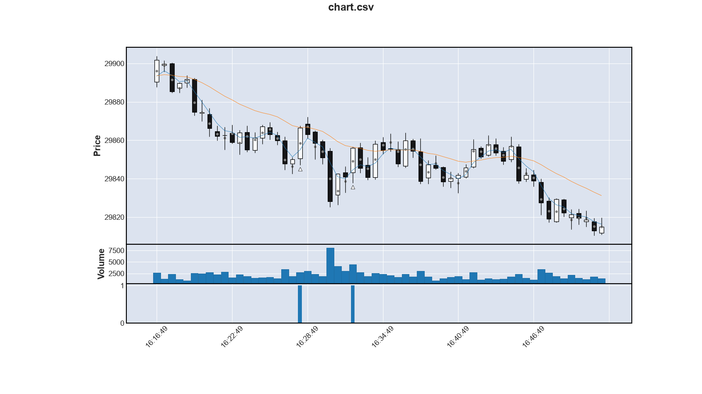

Einstieg zum Marktpreis
=============================

Ein Einstieg zum Marktpreis ist gefährlich.
Er birgt das Risiko, genau auf die Gegenbewegung zu treffen und optimal ungünstig zu kaufen.
Das folgende Chart illustriert das sehr schön:

Ein weiteres Problem beim Kauf zum Marktpreis:
Der Stop-Loss-Kurs kann nur relativ gesetzt werden.

