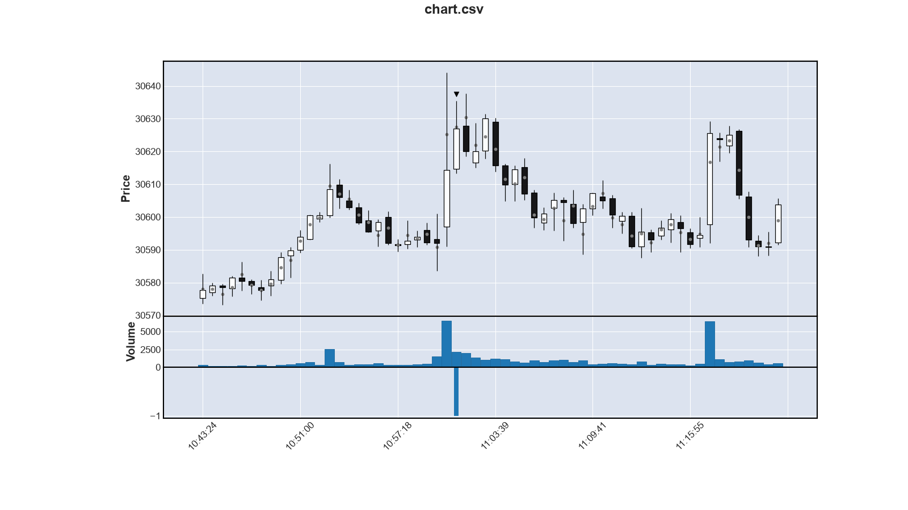

Hephaistos: Erste Ergebnisse
==================================

In [N019](N019-hephaistos.md) sind die Hintergründe für einen schnellen Einstieg in ein KI-basiertes Verfahren erläutert:
KI ist einfach überragend gut, wenn es um Mustererkennung geht.
Deshalb macht es keinen Sinn, manuell Charts zu analysieren
und Verbesserungen algorithmisch zu implementieren.

Wie in [N004](N004-gradient-boosting.md) dargelegt, ist _Gradient Boosting_ das KI-Verfahren erster Wahl.
Die Trainingsdaten von Gradient Bossting kann man sich wie ein große Tabelle vorstellen:
Gradient Boosting schaut sich nacheinander jede Zeile an 
und versucht durch seine _Weak Learner_ den Zielwert immer besser zu erreichen.

Trainingsdaten
-----------------

Unser Daten sind durch die Kerzen zeitlich strukturiert.
Deshalb gibt es pro Kerze eine Zeile in der Trainingstabelle.
Nun geht es darum, die Spalten zu definieren.

Für jeden Zeitschritt haben wir die typischen OHVL-Werte der Kerze und noch ein paar Daten mehr.
Diese geben Auskunft darüber, wie hoch/tief die aktuelle Kerze gerade steht.
Um keine Abhängigkeiten zu absoluten Kursen zu schaffen, 
werden diese Werte relative zum ersten gewichteten Durchschnitt des Tages ausgedrückt.

Im einzelnen gibt es folgende Werte:
    
    open, low, average, high, close, ema_fast, ema_slow

Da _Gradient Boosting_ nicht rechnen kann, 
geben wir die relative Position (deltas) der Werte auch noch mit.
Diese werden jeweils relativ zum gewichteten Durschnitt angeben.
Beispiele:

    delta_open = open - average
    delta_ema_fast = ema_fast - average

Zusätzlich gibt es noch die Differenz zwischen ema_fast und ema_slow.

    delta_ema = delta_ema_fast - delta_ema_slow

Dann kommen ein paar Werte, die die aktuelle Kerze characterisieren:

    wick_top, wick_bottom, delta, range, atr(9), volume.

Jetzt hat Hephaistos ein Bild zur aktuellen Lage.
Er weiß aber noch nichts über die zeitliche Entwicklung.
Da _Gradient Boosting_ immer nur ein Zeile anschaut,
müssen wir in diese Zeile auch Informationen über die Vergangenheit stecken.
Wir machen das, in dem wir die Differenzen der obigen Werte
zu den vorherigen Zeitschritten mit aufnehmen.

Das machen wir für insgesamt 9 Zeitschritte zurück.
Die Werte erhalte jeweils ein `_<n>` als Postfix:
`average_1` ist also die Differenz des aktuellen gewichteten Durchschnitt
zum gewichteten Durchschnitt einen Zeitschritt davor;
`average_9` entsprechen zu gewichteten Durchschnitt 9 Zeitschritte davor.

 
Zielwert
-----------

Die erste Idee war, mit Gradient Boosting die Kursentwicklung vorauszusagen,
also Aussagen wie _Kurs steigt in den nächsten 3 Zeitschritten um 23 ticks_.
Aus dieser Vorhersage kann man dann entscheiden, ob man Long geht.

Um diese Ziel zu erreichen, war das _Target_ für jeden Zeitschritt wir folgt definiert:

    target_i = close_(i + n) - open_(i + 1)

Also als Differenz des Schlusskurses der n-ten Kerze in der Zukunft
und dem Öffnungskurse der nächsten Kerze.
Hintergrund: Wir steigen typischerweise irgendwo in der nähe der Eröffnungskurse der nächsten Kerze ein.
Interessant ist dann zu wissen, wo wir vermutlich in n Kerzen stehen.
Dabei gilt momentan n = 3.

Beim Training hat sich allerdings gezeigt,
dass eine Klassifizierung besser geeignet ist.
Die KI soll also eine _Empfehlung_ abgeben: _Long_, _Short_, _Neutral_.
Klassifikation statt Regression.

Der Hauptvorteil ist, dass wir jetzt Wahrscheinlichkeiten für die 3 Klassen erhalten.
Beispiel: 10% Short, 35% Neutral, 55% Long.
Damit erhalten wir ein gutes Bild über die aktuelle Prognosegenauigkeit der KI
und können bessere Entscheidungen treffen.

Um das zu erreichen, wird während des Trainingsvorgangs das Target einer der Klassen zugeorndet.
Das geschieht über Quantile:
Ein Quantile bestimmt für eine Menge von Werten den Wert,
unter dem x% der Werte des gesamten Menge liegen.
Für die Klassifizierung werden folgende Werte verwendet:

      short:                   target <  quantile(25%)
    neutral:  qunatile(25%) <= target <= quantile(75%)
       long:  quantile(75%) <  target

Erste Ergebnisse
-----------------

Das folgende Diagramm zeigt beispielhaft ein Einstiegssignal vom Hephaistos:

An den 4 Testtagen hat Hephaistos folgende Ergebnisse erreicht:

    session     trades    wins  losses  win_rate  ticks  total  p_factor  max_win  max_loss
    2026-09-28       7       4       3     57.14    822    822    8.0862      373       -63
    2026-10-06       0
    2026-10-14       8       2       6     25.00   -102   -102    0.7251      169      -102
    2026-10-22       8       4       4     50.00    220    220    1.6748      268      -101
    total           23      10      13     43,35    940    940                373      -102

Diese Ergebniss wurden mit folgenden Einstellungen erreicht:

 * Einstieg erfolgt bei ein Wahrscheinlichkeit > 50%
 * Stop-Loss: 100 Ticks
 * Faktor für die Stop-Loss-Nachführung: 0.6

Interessant ist, dass am 06.10.2026 gar nicht gehandelt wurde:
Es gab keinen Fall, bei dem die Wahrscheinlichkeit für Long oder Short über 50% lag.

Ein Tag war schlecht, zwei andere gut bis sehr gut.
Mit diesem Ergebnis schlägt Hephaistos Yesterdays Weather und Turning Point praktisch aus dem Stand.
Das bestätigt die Annahme, dass die KI bei der Mustererkennung überlegen ist.

Der Stop-Loss ist relativ hoch gewählt, 
um ein direktes Ausstoppen nach dem Einstieg zu verhindern.
Das Beispiel oben zeigt sehr schön, warum das nötig ist.
In Relation zum hohen Stop-Loss ist die Nachführung mit 0.6 eher gering.
Eine schnellere Nachführung kann das Ergebnis verbessern,
zum Beispiel am 28.09.2026:

    session     trades    wins  losses  win_rate  ticks  total  p_factor  max_win  max_loss
    2026-09-28       7       4       3     57.14    851    851   10.2500      405       -54

Alles gleich wie oben nur Nachführung 0.75 statt 0.6.
Ergebnis: Gewinn steigt von 822 auf 851 Ticks.

Fazit
----------

Trotz den geringen Trainingsdaten und den eingeschränkten Werten
ist Hephaistos bereits den algorithmischen Verfahren überlegen.
Es macht daher keinen Sinn mehr,
weitere Zeit in die Verbesserung der algorithmischnen Ansätze zu stecken.
Volle Konzentration auf Hephaistos!

Nächste Schritte
-------------------

 * Um Verbesserungen besser, schneller und ohne viel Aufwand bewerten zu können,
   müssen die _Back Testing_ Möglichkeiten ausgebaut werden.
 * Mit der Zeit kommen mehr Lerndaten hinzu.
   Das bringt vermutlich von selbst Verbesserungen.
 * Wir brauchen weitere Kennzahlen, die es Hephaistos ermöglichen,
   bessere Entscheidungen zu treffen.
   Ein paar Kandidaten hierfür sind im Anhang 2 gelistet.
 * Wir brauchen intelligentere Verfahren für das Stetzen und Nachführen des Stop-Loss.

Anhang 1: Filterung hoch-dynamischer Börsenzeiten
--------------------------------------------------

Der erste Versuch mit Hephaistos ist gescheitert.
Der Grund lag in der Klassifizierung über die Quantile:
Die höchsten Gewinne und Verluste entstehen in den dynamischsten Phasen des Marktes:

 * Zu Beginn der Session
 * Bei der Eröffnung der Nasdaq
 * Am Ende der Session

Das Ergebnis war, dass Hephaistos nur in diesen Phasen gehandelt hat.
Rr gelernt hat, dass in diesen Zeiten die Wahrscheinlichkeit am größten ist
dass hohe Gewinne und Verluste entstehen.
Das hat zu sehr schlechten Ergebnissen geführt,
weil die Kurse in diesen Zeiten am schlechtesten vorhersagbar sind.

Deshalb müssen diese Phasen beim Trainingsvorgang herausgenommen werden.
Dann handelt Hephaistos während der ganzen Session
und die Erfolge sind wesentlich besser.

Anhang 2: Mögliche Erweiterungen der Trainingsdaten
----------------------------------------------------

Unser EMA_SLOW ist - auch wenn er _slow_ heißt - ziemlich schnell.
Vielleicht macht es Sinn, einen dritten, noch langsameren Durchschnitt mit aufzunehmen,
damit Hephaistos den Tagestrend besser einschätzen kann.
Wie hätten dann drei gleitende Durchschnitte: fast, mid, slow,
wobei der bisherige slow zum mid wird.

Bisher hat Hephaistos noch keine Information über Hochs und Tiefs.
Hochs und Tiefs sind aber in der technischen Analyse sehr verbreitet.
Werte wie _Abstand zum Tages-Hoch/-Tief_ oder _Abstand zum letzten Hoch/Tief_
könnten helfen.

Momentan sind noch keinerlei Daten zum Volumenprofile/Orderflow enthalten.
Das braucht es sicherlich.