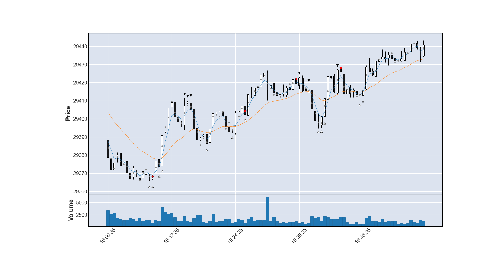

Bullseye and tripple barrier labeled chart
==============================================

Die nächste Abbildung zeigt ein Chart mit Bullseye und Tripple Barrier Labels:

Die roten Punkte sind Bullseye Labels.
Sie zeigen den Beginn eines Trends an.
Ein Trend ist in diesem Fall:

> 5 aufeinander folgende fallende oder steigende Durchschnittskurse.

Die schwarzen und weißen Dreiecke zeigen profitable Einstiegsmöglichkeiten an.
Sie sind mit der Tripple-Barrier-Methode gelabelt.
Die Parameter sind:
 
 * Fenstergröße: 6 Kerzen
 * Risiko: 12 Ticks
 * Profit: 48 Ticks

Diese Labels sind jetzt der Ausgangspunkt,
um die KI zu trainieren.
Jetzt heißt es Features finden, 
die der KI eine zuverlässige Voraussage ermöglichen!
